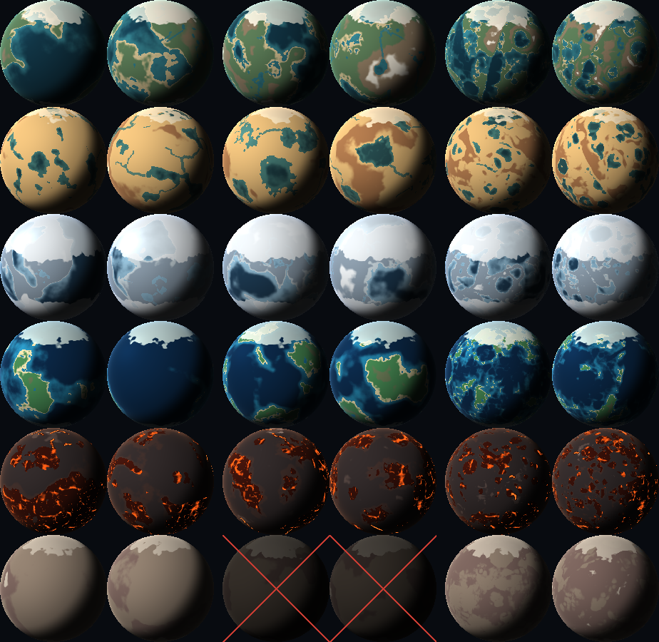

# Atlas profili i metod terenu

Plik generowany przez `npm run atlas` — nie edytuj ręcznie.

**Jak czytać obrazek:** wiersze to profile (od góry): terrestrial (ziemiopodobny), arid (pustynny), ice (lodowy), oceanic (oceaniczny), volcanic (wulkaniczny), barren (jałowy).
Kolumny to trzy grupy metod (od lewej): tectonic, erosion, fractured — w każdej grupie dwie planety (seedy 1:17:4 i 1:52:3).
Widok 2D jak w grze. Kombinacja niezgodna z profilem jest przygaszona i przekreślona.

**Kombinacje niezgodne:**
- **barren × erosion** — bez wody i atmosfery nie ma erozji wodnej — doliny rzeczne byłyby fałszywym śladem

**Metryki** (model na siatce detail 24): ląd — udział lądu; chaos — udział drobnych nierówności; stromość — średnia różnica wysokości z sąsiadem; płaskie — udział prawie płaskiego lądu; igła — największe odchylenie od sąsiadów; jeziora — liczba jezior (woda albo lawa); rzeki, lawa — udział powierzchni; pieczenie — czas liczenia kształtu i hydrologii (ms, komputer, nie iPad).

| Profil | Metoda | Seed | Ląd | Chaos | Stromość | Płaskie | Igła | Jeziora | Rzeki | Lawa | Pieczenie (ms) |
|---|---|---|---|---|---|---|---|---|---|---|---|
| terrestrial | tectonic (preferowana) | 1:17:4 | 0,45 | 0,051 | 0,0144 | 0,055 | 0,050 | 6 | 0,7% | 0,0% | 267 |
| terrestrial | tectonic (preferowana) | 1:52:3 | 0,79 | 0,059 | 0,0156 | 0,029 | 0,088 | 34 | 1,5% | 0,0% | 100 |
| terrestrial | erosion | 1:17:4 | 0,45 | 0,083 | 0,0234 | 0,001 | 0,056 | 10 | 0,1% | 0,0% | 182 |
| terrestrial | erosion | 1:52:3 | 0,79 | 0,064 | 0,0164 | 0,003 | 0,038 | 29 | 1,7% | 0,0% | 197 |
| terrestrial | fractured | 1:17:4 | 0,45 | 0,214 | 0,0381 | 0,000 | 0,129 | 35 | 0,0% | 0,0% | 96 |
| terrestrial | fractured | 1:52:3 | 0,80 | 0,195 | 0,0405 | 0,000 | 0,128 | 77 | 0,9% | 0,0% | 50 |
| arid | tectonic | 1:17:4 | 0,93 | 0,078 | 0,0161 | 0,007 | 0,079 | 7 | 1,9% | 0,0% | 62 |
| arid | tectonic | 1:52:3 | 0,95 | 0,062 | 0,0184 | 0,005 | 0,069 | 11 | 2,7% | 0,0% | 73 |
| arid | erosion (preferowana) | 1:17:4 | 0,93 | 0,070 | 0,0187 | 0,001 | 0,043 | 8 | 1,5% | 0,0% | 195 |
| arid | erosion (preferowana) | 1:52:3 | 0,95 | 0,063 | 0,0214 | 0,002 | 0,078 | 7 | 1,9% | 0,0% | 159 |
| arid | fractured | 1:17:4 | 0,93 | 0,222 | 0,0404 | 0,000 | 0,162 | 11 | 0,7% | 0,0% | 57 |
| arid | fractured | 1:52:3 | 0,95 | 0,219 | 0,0445 | 0,000 | 0,199 | 22 | 0,9% | 0,0% | 49 |
| ice | tectonic (preferowana) | 1:17:4 | 0,50 | 0,065 | 0,0191 | 0,022 | 0,090 | 19 | 0,7% | 0,0% | 61 |
| ice | tectonic (preferowana) | 1:52:3 | 0,68 | 0,072 | 0,0155 | 0,077 | 0,072 | 23 | 1,0% | 0,0% | 60 |
| ice | erosion | 1:17:4 | 0,50 | 0,059 | 0,0183 | 0,006 | 0,035 | 12 | 1,0% | 0,0% | 192 |
| ice | erosion | 1:52:3 | 0,68 | 0,058 | 0,0158 | 0,007 | 0,037 | 19 | 1,5% | 0,0% | 177 |
| ice | fractured | 1:17:4 | 0,50 | 0,193 | 0,0385 | 0,000 | 0,165 | 32 | 0,0% | 0,0% | 44 |
| ice | fractured | 1:52:3 | 0,69 | 0,216 | 0,0331 | 0,000 | 0,124 | 67 | 0,3% | 0,0% | 48 |
| oceanic | tectonic (preferowana) | 1:17:4 | 0,13 | 0,073 | 0,0209 | 0,001 | 0,062 | 3 | 0,0% | 0,0% | 55 |
| oceanic | tectonic (preferowana) | 1:52:3 | 0,16 | 0,072 | 0,0214 | 0,000 | 0,081 | 1 | 0,0% | 0,0% | 63 |
| oceanic | erosion | 1:17:4 | 0,13 | 0,087 | 0,0272 | 0,001 | 0,061 | 2 | 0,0% | 0,0% | 154 |
| oceanic | erosion | 1:52:3 | 0,16 | 0,068 | 0,0230 | 0,001 | 0,050 | 1 | 0,0% | 0,0% | 140 |
| oceanic | fractured | 1:17:4 | 0,13 | 0,263 | 0,0434 | 0,000 | 0,168 | 3 | 0,0% | 0,0% | 49 |
| oceanic | fractured | 1:52:3 | 0,16 | 0,232 | 0,0432 | 0,000 | 0,155 | 3 | 0,0% | 0,0% | 45 |
| volcanic | tectonic | 1:17:4 | 0,74 | 0,079 | 0,0168 | 0,016 | 0,107 | 11 | 0,0% | 9,7% | 70 |
| volcanic | tectonic | 1:52:3 | 0,66 | 0,080 | 0,0199 | 0,003 | 0,108 | 13 | 0,0% | 3,2% | 73 |
| volcanic | erosion | 1:17:4 | 0,74 | 0,088 | 0,0235 | 0,001 | 0,054 | 9 | 0,0% | 2,7% | 170 |
| volcanic | erosion | 1:52:3 | 0,66 | 0,085 | 0,0263 | 0,000 | 0,066 | 6 | 0,0% | 2,3% | 164 |
| volcanic | fractured (preferowana) | 1:17:4 | 0,74 | 0,256 | 0,0473 | 0,000 | 0,152 | 44 | 0,0% | 5,2% | 47 |
| volcanic | fractured (preferowana) | 1:52:3 | 0,65 | 0,269 | 0,0514 | 0,000 | 0,226 | 27 | 0,0% | 2,6% | 48 |
| barren | tectonic | 1:17:4 | 1,00 | 0,068 | 0,0172 | 0,005 | 0,072 | 0 | 0,0% | 0,0% | 33 |
| barren | tectonic | 1:52:3 | 1,00 | 0,077 | 0,0231 | 0,001 | 0,112 | 0 | 0,0% | 0,0% | 44 |
| barren | erosion ✗ | 1:17:4 | 1,00 | 0,079 | 0,0261 | 0,000 | 0,056 | 0 | 0,0% | 0,0% | 144 |
| barren | erosion ✗ | 1:52:3 | 1,00 | 0,075 | 0,0261 | 0,000 | 0,048 | 0 | 0,0% | 0,0% | 135 |
| barren | fractured (preferowana) | 1:17:4 | 1,00 | 0,250 | 0,0441 | 0,000 | 0,131 | 0 | 0,0% | 0,0% | 20 |
| barren | fractured (preferowana) | 1:52:3 | 1,00 | 0,257 | 0,0466 | 0,000 | 0,172 | 0 | 0,0% | 0,0% | 23 |
