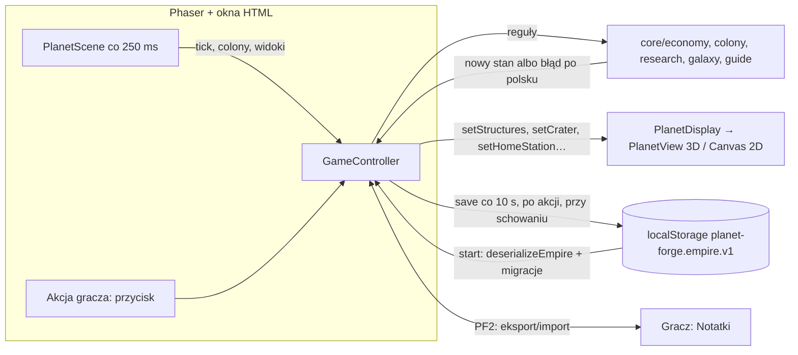

# Audyt projektu Planet Forge — listopad 2026

Stan: 2026-11-03, gałąź `main` @ v0.69.1 (`3281249`). Raport na gałęzi `claude/audyt-2026-11` — **w grze nic nie
zmieniono** (tylko ten raport, `docs/audyt/pomiary.md` i skrypty `scripts/audyt/`). Liczby: `docs/audyt/pomiary.md`.

Oznaczenia: **[zmierzone]** — liczba z pomiaru, **[kod]** — sprawdzone w kodzie (plik:linia), **[przypuszczenie]** —
wniosek bez pomiaru. Pilność: 🔴 krytyczne, 🟠 ważne, 🟢 miłe do zrobienia.

## 0. Zanim zacząłem

- `npm run check` przed audytem [zmierzone]: TypeScript 0 błędów, **406 / 406 testów**, build OK (`dist/index.html`
  2,35 MB). Po audycie ten sam wynik (sekcja 9).
- **Gałęzie** [kod, `git rev-list`]: 93 gałęzie zdalne. Gałęzie z prompta: `claude/kompleks-kopalni-metalu` (0 commitów
  ponad main, 54 za main) i `claude/widok-ukladu` (0 ponad main) — **w całości są już w main**, nic nie czeka.
  Wszystkie gałęzie z lat v0.38+ też mają 0 commitów ponad main. Gałęzie z commitami „ponad main” to tylko bardzo stare
  (v0.2–v0.26, `claude/animacje-ui`, `imperium-wyglad`, `kolejka-budowy`, `specjalizacje`, `zgloszenie-1-zaciecia` …
  z 2026-10-22…26) — ich treść weszła do main innymi commitami (historia była przepisywana przy odtwarzaniu źródeł,
  `docs/decisions.md` v0.2). Dla gracza: nic. 🟢 Można je kiedyś usunąć (porządek; decyzja właściciela).

## 1. Stan projektu

**Wersja i co działa** [kod + testy]: v0.69.1 — pełna pętla MVP z `docs/kandydat-mvp.md` jest w kodzie i ma testy:
planeta i pola (`core/colony`), 6 budynków do poz. 40, kompleksy i megakonstrukty metalu (`core/colony/complexLayout.ts`,
`core/economy/metalConstruct.ts`) i kryształów (`core/economy/crystalConstruct.ts`), orbita konstruktów, złoża
i wyeksploatowanie, transport, stacja macierzysta i stacje kolonii, flota z eskortą, ryzyko misji, imperium gwiezdne,
przewodnik SI Matki, widok układu, badania, galaktyka, SI Matka, zapis z migracjami, PWA.

**Opis bez kodu / kod bez opisu** [kod + `grep` ścieżek z dokumentów]:
- Dokumenty wskazują 10 nieistniejących plików. 9 z nich to **plany** w `docs/generator-plan.md` (np.
  `src/game/scenes/PlanetLabScene.ts` — „Laboratorium planet”, `src/game/ui/navBar.ts`, `core/surface/validate.ts`):
  te etapy planu nie powstały albo powstały pod innymi nazwami. Dla gracza: nic; dla następnej sesji AI: mylące. 🟢
- `docs/technical-brief.md` — opisany jako nieistniejący (CLAUDE.md, LORE_TOUCHPOINTS) — poprawnie.
- Nagłówki „Stan: v0.46” w `ARCHITECTURE.md`, `UI.md`, `RENDERING.md`, `TESTING.md` (tam „298 testów”, jest 406),
  `MECHANICS.md`, `KNOWN_ISSUES.md` — treść dopisywana później, nagłówek nieaktualny. README: lista kontrolna „v0.46”. 🟢
- CLAUDE.md: „PlanetScene.ts (~2300 wierszy)” — jest 2742; „Imperium: do 5 planet (10 później)” — 10 jest już od v0.63
  (imperium gwiezdne); lista „Najbliższe etapy” jest starsza niż plan MVP (CLAUDE.md sam to zaznacza). 🟢
- Kod bez opisu: nie znalazłem większych mechanik bez wpisu w `MECHANICS.md`. Brakuje wpisu o naprawie przeklikiwania
  okien w `UI.md` (jest w `decisions.md`). 🟢

**Martwy kod** [`node scripts/audyt/unused.ts`]: 1 nieużywany eksport (`isSeaCell` w `core/colony/fieldGrid.ts`),
0 nieużywanych plików, 0 cykli importów (`scripts/audyt/cycles.ts`). Zależności w `package.json`: tylko `phaser`
i `three` (obie używane) + narzędzia. Pozostałość prototypu: lej „w miejscu z dala od zabudowy” (`craterSite`, pole −1
w `CraterLook`) — używa go już tylko skrypt zrzutów, w grze nieużywany. 🟢

**Rozmiar `dist/index.html`** [zmierzone]: 2,35 MB (JS 2,39 MB przed wstawieniem do HTML). Największe składniki:
**Phaser 1,18 MB (49%)**, Three.js 0,55 MB (23%), kod gry 0,64 MB (27%; z tego `GameController.ts` 102 KB,
`PlanetScene.ts` 64 KB). Phaser rysuje tylko panele (Canvas 2D) — to połowa pliku. Dla gracza: dłuższe pierwsze
wczytanie (potem PWA trzyma plik w pamięci). 🟢 (zamiana Phasera na własne panele to duża praca; nie teraz)

## 2. Architektura i jakość kodu

**Zasady z CLAUDE.md** [kod, `grep`]:
- `core/` bez phaser/three/DOM — **przestrzegane** (0 importów; `localStorage` tylko w `core/save/empire.ts` w try/catch,
  zgodnie z wyjątkiem).
- UI zmienia stan tylko przez `GameController` — **przestrzegane** (0 przypisań stanu w `src/game`, `src/planet-renderer`).
- `Math.random` — tylko w `planet-renderer/spaceBackground.ts:162–179` (spadające gwiazdy w tle) — dozwolone (wygląd,
  nie logika). W logice wyłącznie `core/random/rng.ts`.
- `Date.now()` w core tylko w `core/time/worldClock.ts` (zegar świata, podmienialny w testach) — dobrze.
- `GENERATOR_VERSION` nie był podbijany; `SURFACE_VERSION`, `FIELD_GRID_VERSION`, `PLOTS_LAYOUT` — zmieniane świadomie
  (zapisy w `decisions.md`). Uwaga: v0.69.1 zmieniła **kształt obszaru Ekstraktora kryształów** bez podbicia
  `PLOTS_LAYOUT` — celowo (stare zapisy przeliczają obszar sam, budynki na drodze przenoszą się obok) [kod:
  `GameController.ts` `fixedPlots`].

**Największe pliki** [zmierzone, liczba wierszy]: `GameController.ts` **4440** (wszystkie akcje gracza, widoki dla UI,
zapis, naliczanie, orbita, flota, przewodnik — kilkanaście odpowiedzialności), `PlanetScene.ts` 2742, `colonyMeshes.ts`
1994 (41 kształtów budowli w jednym pliku), `PlanetView.ts` 1487, `MapScene.ts` 1416, `CanvasPlanetFallback.ts` 1249,
`EmpireScene.ts` 1112. Duplikacja [kod]: megakonstrukt metalu i kryształów mają osobne, podobne metody orbity
(`launchConstruct`/`launchCrystal` itd.) — świadomie, żeby nie ruszać działającego metalu; do połączenia przy
porządkach. Dla gracza: nic; dla rozwoju: każda zmiana w `GameController` jest ryzykowniejsza i wolniejsza. 🟠

**Typy** [`grep`]: 31 użyć `any` — wszystkie w odczycie zapisu (`core/save/*`, parsery w `core/economy`), gdzie dane są
nieznane i sprawdzane pole po polu; 0 `@ts-ignore`/`@ts-nocheck`; 2 × `as unknown as` (`PlanetScene`, testy). ok. 920
operatorów `!` (pewność, że wartość jest) — typowe dla tego kodu, ryzyko pojedynczych wyjątków przy błędnych danych.

**Błędy, które mogą zatrzymać grę** [kod]: `main.ts:338–345` łapie `error` i `unhandledrejection` do diagnostyki,
`app/bootGuard.ts` przy awarii startu 3D wraca do 2D, uszkodzony zapis → kopia + komunikat. Wyjątek w `update()` sceny
Phaser (np. w `refreshValues`) **zatrzymałby odświeżanie paneli bez komunikatu dla gracza** (Phaser nie ma tam
try/catch; w kodzie gry: 1 × `try` w `PlanetScene.ts`) [kod; przypuszczenie co do skutków]. Nie znalazłem miejsca, które
dziś rzuca wyjątek (testy + 2 dni gry właściciela bez „ostatnich błędów” w diagnostyce). 🟠 mała poprawka: osłona
`update()` z komunikatem „Coś poszło nie tak — odśwież” i wpisem w diagnostyce.

## 3. Optymalizacja i płynność

Pomiary: `docs/audyt/pomiary.md`. Headless to przybliżenie — iPad właściciela (v0.69.0, 3D): **58 kl./s średnio,
35 najsłabsza sekunda** [zmierzone przez właściciela].

| Miejsce | Koszt | Pomysł na poprawę | Ryzyko |
|---|---|---|---|
| Pierwsze liczenie siatki pól planety (zmiana planety, start, 2D↔3D) | 300–640 ms na komputerze [zmierzone]; na iPadzie przypuszczalnie 1–2 s „przycięcia” — **zgłoszone przez właściciela** | Zapisywać gotową siatkę (IndexedDB) albo liczyć w Web Workerze; liczone już w tle dla sąsiadów (v0.66) | średnie |
| Przejście 2D↔3D | przeładowanie gry + budowa modelu 3D [kod: `bootGuard`, `main.ts`] | jednorazowe; można pokazać „Przełączam grafikę…” | małe |
| Odświeżanie paneli co 250 ms: `tick()` + `colony()` (przeliczenie pól) | 0,1 ms + 1,2 ms [zmierzone] | przeliczać pola tylko po zmianie poziomu/kompleksu | małe |
| Phaser rysuje panele każdą klatkę | w bezruchu renderer planety zwalnia do ~20 kl./s (v0.66), panele Phasera nie [kod] | rysować panele tylko po zmianie (było w planie UI, etap 7) | średnie |
| Scena 3D | 49 rysowań, 110–133 tys. trójkątów, 2 tekstury [zmierzone] | w normie (cel z PERFORMANCE.md: < 60 rysowań) | — |
| Kształty budowli | 41 rodzajów × 4 InstancedMesh; najcięższy „generator fuzyjny” 2296 trójkątów [zmierzone] | w normie; stała liczba rysowań niezależnie od poziomu | — |
| Wycieki | 10 i 20 zmian planety: pamięć 34 → 39 → 39 MB (2D), geometrie 53 → 67 → 67 (3D) [zmierzone] | brak wycieku (pamięć 3 modeli 3D i siatek) | — |
| Wielkość pliku gry | 2,35 MB, Phaser 49% [zmierzone] | — (patrz sekcja 1) | duże |

Nie mierzyłem osobno 10× otwierania/zamykania paneli i 10× Mapy (skrypt `perf.ts` tego nie robi) — do dopisania przy
okazji poprawek płynności. 🟢

## 4. Przepływ danych

- **Zapis** [kod `core/save/empire.ts`, zmierzone]: 7 KB przy 5 planetach, 0,08 ms na zapis — nie blokuje klatek.
  Brak miejsca / tryb prywatny: zapis w try/catch → komunikat „nieudany zapis” raz, gra działa dalej (v0.46).
- **Nieobecność** [kod `core/economy/economy.ts`, zmierzone]: limit 8 h produkcji na naliczenie; wczytanie po 8 h
  przy 5 planetach 4 ms. Nieaktywne planety nadrabiają czas dopiero przy przejściu na nie (`advanceSlot`) — tanio.
  Długie loty, budowy konstruktów, orbita i znaleziska przetwarzane są „do chwili now” także offline (`process*`).
- **SI Matka pod nieobecność** [kod `core/ai/offline.ts`, `GameController.runAwayAi`]: liczy na stanie aktywnej planety
  po naliczeniu; testy `advisor` (8) sprawdzają, że nie buduje podwójnie. Nie znalazłem podwójnego liczenia [kod].
- **PWA** [kod `app/serviceWorker.ts`]: cache-first, pamięć nazwana wersją buildu, nowa wersja czeka na „Odśwież”
  (bez `skipWaiting`), stare pamięci usuwane przy aktywacji. Ryzyko starej wersji: gracz, który nie dotknie paska
  aktualizacji, gra na starej. Nowa wersja czyta stare zapisy; **stara wersja czyta nowy zapis, ale przy swoim zapisie
  gubi pola, których nie zna** (np. lej `crystalComplex` z v0.69) [kod: parsery pomijają nieznane pola] — zdarzy się
  tylko, gdy ten sam zapis jest używany naprzemiennie w nowej i starej wersji (np. Safari i ekran początkowy w różnych
  wersjach, wklejony PF2). 🟢 (rzadkie; można ostrzegać przy imporcie zapisu z nowszej wersji)

## 5. „Baza danych” — zapis i dane gry

- Format: `docs/SAVE_FORMAT.md` (aktualny po v0.69: `crystalComplex`, `orbiting.kind`). `EMPIRE_VERSION` 2; wszystkie
  nowe pola opcjonalne z walidacją (błędne pomijane) [kod].
- **Stare zapisy** [testy]: `tests/oldSaves.test.ts` — 7 prawdziwych zapisów z v0.46, v0.50, v0.54, v0.58, v0.61, v0.64,
  v0.66 (wczytanie, 8 h, przejścia, PF2). **Brak** zapisów z v0.67–v0.69 i sprzed v0.46 (te ostatnie mają testy
  migracji w `save.test.ts`/`controller.test.ts`, ale nie prawdziwe pliki). 🟢 dopisać v0.68 i v0.69.
- Dane liczone, a zapisywane [kod `GameController.ts` zapis slotu]: `economy.siteFactor`, `economy.energyFactor`
  (liczone z pól i kompleksów przy każdym przeliczeniu), `fields` (pamięć dla listy planet). Nieszkodliwe (mały rozmiar),
  ale gdyby zapis i reguły się rozjechały, wygrywa przeliczenie — tak jest dziś [kod: `syncPlots`].
- Walidacja importu [testy `save`, `transfer`]: uszkodzony PF2 → komunikat po polsku, gra bez zmian; zły JSON w pamięci
  → kopia `planet-forge.empire.broken`.
- `src/data`: statusy `robocza` są przy nazwach; liczby balansu są głównie w `balance.ts`, ale też w `data/fleet.ts`,
  `data/finds.ts`, `data/guide.ts` (nagrody), `data/complexes.ts` (koszty kompleksów), `data/openPit.ts`, oraz wygląd
  leja w `planet-renderer/crater.ts` (etapy) [kod]. `BALANCE.md` obejmuje tylko część z nich. 🟢 przy strojeniu
  ekonomii zebrać w jednym miejscu.

## 6. Dokumentacja

- Nieaktualne: nagłówki „Stan: v0.46” (6 plików), README lista kontrolna v0.46, `TESTING.md` „298 testów”, CLAUDE.md
  (rozmiar `PlanetScene`, „10 później”, stara lista etapów). Sprzeczność: CLAUDE.md „Do zrobienia później — poprawa wyglądu
  Ekstraktora” vs v0.69 (nowy wygląd leja zaakceptowany) — do odhaczenia. 🟢
- Odwołania do nieistniejących plików: 9 planów w `generator-plan.md` (sekcja 1).
- **Proponowany układ** (bez przenoszenia): `docs/README.md` — spis; `docs/gra/` (MECHANICS, BALANCE, UI, SAVE_FORMAT),
  `docs/technika/` (ARCHITECTURE, RENDERING, PERFORMANCE, TESTING), `docs/decyzje/` (decisions + plany i raporty
  etapów: kompleks-kopalni-metalu, megakonstrukt-krysztalow, plan-ekonomii, kandydat-mvp…), `docs/pomiary/` i
  `docs/audyt/` jak dziś, `docs/archiwum/` (plany zrealizowane: generator-plan, plan-przemysl, raport-galaktyka,
  audyt-grafiki-v047, specyfikacja-generatora-i-ui), `docs/lore/` bez zmian. CLAUDE.md krótszy — tylko zasady i wskazania.
- **Lore** [kod + `docs/LORE_TOUCHPOINTS.md` + `docs/lore/CANON_STATUS.md`]: Imperium, formy obce, boty, antymateria,
  typy planet, piraci, wiertnica — opisane jako ROBOCZE. **Brakuje w spisie**: „Flota cywilna” (`data/research.ts:67, 333`)
  i flota z **okrętami eskorty** (v0.58, `data/fleet.ts`) — eskorta to element zbliżony do walki, a K-005 mówi, że walka
  flot nie jest sercem gry (O-206 otwarte). 🟢 dopisać do spisu.

## 7. Testy

- 406 testów w 64 plikach [zmierzone]. Dobrze pokryte: ekonomia (21), kontroler (18), pola (13), badania (12), kolejka,
  złoża, generator, zapis (8 + stare zapisy), SI (8), megakonstrukty, orbita, flota, ryzyko misji, przewodnik.
- Słabiej: interfejs Phaser (tylko układ `layout`, gesty, karty — bez testu klikania paneli), renderer 3D (tylko
  matematyka: pick, openPit, drill, sky), widok układu (2), stacje kolonii (2), imperium gwiezdne (2).
- Nowa poprawka przeklikiwania okien (v0.69.1) jest sprawdzona skryptem Playwright, ale **nie ma testu** w `npm test`. 🟢
- Kruche / zależne od czasu: `tests/orbits.test.ts:58` porównuje zegar świata z `Date.now()` (tolerancja 1 s — może
  zawieść na bardzo wolnej maszynie); reszta używa stałych chwil i seedów. Losowość: tylko przez seedy.

## 8. Co dopracować — priorytety

| # | Pilność | Co | Dla gracza | Rozmiar | Ryzyko | Sesja |
|---|---|---|---|---|---|---|
| 1 | 🟠 | Przycięcie przy zmianie planety i 2D↔3D: siatka pól z pamięci (IndexedDB) albo w Web Workerze | zgłoszone „spadki klatek” | średni | średnie (zapis siatki — nowa pamięć) | osobna |
| 2 | 🟠 | Osłona pętli `update()` paneli: przy wyjątku komunikat + wpis w diagnostyce zamiast cichego zatrzymania | gra nie „zamarza” po cichu | mały | małe | razem z 3 |
| 3 | 🟠 | Podział `GameController.ts` (4440 wierszy) na moduły: orbita/konstrukty, flota, imperium, zapis, widoki | nic widocznego; szybsze i bezpieczniejsze zmiany | duży | średnie (dużo testów chroni) | 2–3 sesje |
| 4 | 🟠 | Podział `PlanetScene.ts` (2742) — plan „etap 7 UI” | nic widocznego | średni | średnie | osobna |
| 5 | 🟢 | Panele Phaser rysowane tylko po zmianie | mniej grzania iPada w bezruchu | średni | średnie | po pomiarze iPada |
| 6 | 🟢 | Zapisy-wzorce z v0.68 i v0.69 do `tests/fixtures/saves` + test przeklikiwania okien | ochrona zapisów | mały | małe | z 2 |
| 7 | 🟢 | Dokumentacja: nagłówki, README, TESTING, CLAUDE.md, spis lore (Flota cywilna, eskorta), układ `docs/` | — | mały | brak | 1 sesja |
| 8 | 🟢 | Porządek: usunąć stare gałęzie, `isSeaCell`, resztki prototypu leja (`craterSite`) | — | mały | brak | z 7 |
| 9 | 🟢 | Tama leja także w 2D | spójność 2D/3D | mały | małe | dowolna |
| 10 | 🟢 | Liczby balansu w jednym miejscu (przed strojeniem ekonomii) | — | średni | małe | z ekonomią przed MVP |

**Krytycznych (🔴) nie znalazłem**: brak utraty zapisu, zawieszeń ani błędów w testach; przeklikiwanie okien naprawione
w v0.69.1.

## 9. Po audycie

`npm run check` po dodaniu raportów i skryptów: wynik jak przed audytem (0 błędów TS, 406 / 406, build OK) — skrypty
w `scripts/audyt/` nie są częścią testów ani buildu.

## Lista do sprawdzenia ręcznie na iPadzie

1. Zmiana planety (☰ → lista): ile trwa przycięcie przy **pierwszym** wejściu na planetę i przy drugim (powinno zniknąć).
2. Ustawienia → Włącz 3D / Wróć do 2D: czas do gotowej planety.
3. 5 minut bezruchu w 3D i w 2D: czy iPad się grzeje (panele Phasera rysują się cały czas).
4. Ustawienia → Zgłoś / diagnostyka: „płynność (ostatnia minuta)” po minucie obracania i przybliżania — 2D i 3D.
5. Okna (Kompleks, Ustawienia, diagnostyka): dotknięcia w oknie nie mogą zmieniać niczego pod spodem (v0.69.1).
6. Zamknięcie Safari na 8+ godzin i powrót: komunikat o nieobecności, planety nadrabiają czas przy przejściu.
